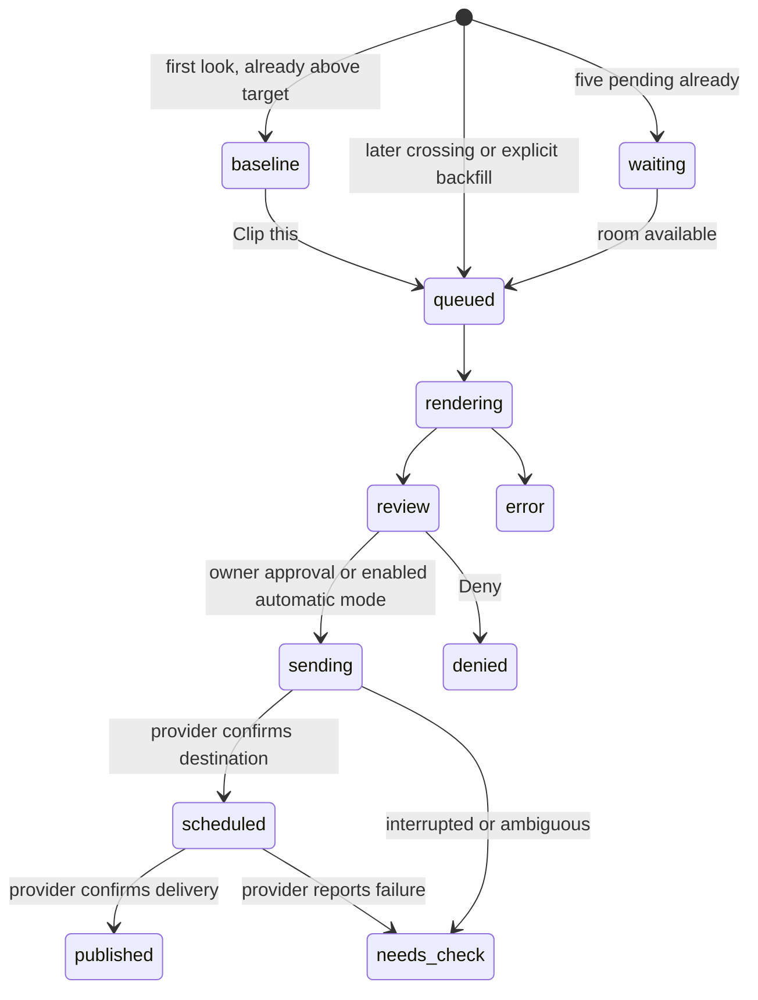

# Architecture

The browser dashboard talks to a small FastAPI server. SQLite holds watches, clip observations, the work queue, reserved slots and the publication outbox. A single background worker checks the public Twitch Clips API, downloads authorized source media, renders whole vertical output and calls WoopSocial. No desktop Clips Kitty server, frontend bundle or database is imported.

`engine/` contains the disclosed upstream provider and Gaming libraries. `feed.py` adapts the in-period Twitch window-splitting algorithm. `store.py`, `service.py`, `app.py`, `media.py` and `static/` provide the standalone application. See the exact snapshot in [provenance](../PROVENANCE.md).

## State transitions

Admission and render claims use immediate SQLite transactions. Public sends put the clip on durable hold before networking. A restart requeues interrupted renders but never automatically resends an ambiguous publication. The saved media ID/request ID and WoopSocial dashboard support manual inspection. There is no resend endpoint for `needs_check`; inspect provider state before any manual recovery.

All watches share a five-per-day/default-five-upcoming policy. Reserved slots are computed in the configured IANA timezone, with UTC spacing and next-day local anchors across daylight-saving transitions. Slot reservations remain recorded after publication. This scheduler does not import other tools' provider posts.

## Owner API

All routes except `GET /health` require HTTP Basic authentication, username `owner`. Mutating routes require `X-Autopilot-Action: 1` and JSON. No CORS access is enabled. Use HTTPS for remote hosting. Token/key inputs never appear in public status or validation responses; secrets are encrypted at rest using a volume-persistent Fernet key.

| Route | Purpose |
|---|---|
| `GET /api/status` | Saved settings, connection flags, watches, clips, posts, events |
| `POST /api/settings` | Public client ID, write-only provider key, budget/timezone |
| `POST /api/twitch/start` | Begin scope-free public-client device authorization |
| `POST /api/twitch/poll` | Finish a specific pending device flow |
| `POST /api/connections` | Read WoopSocial projects/accounts |
| `POST /api/instagram` | Select an explicitly connected Instagram profile |
| `POST /api/automation` | Start/pause watching and processing |
| `POST /api/watches` | Add a channel, view target, lookback, mode and render options |
| `PATCH /api/watches/{id}` | Edit target, enabled state, mode or rendering preferences |
| `POST /api/watches/{id}/check` | Read current real Twitch clips |
| `POST /api/clips/{id}/queue` | Queue an earlier/failed/denied clip idempotently |
| `POST /api/clips/{id}/approve` | Approve review output for the displayed selected Instagram |
| `POST /api/clips/{id}/deny` | Decline unsent work |
| `GET /media/{id}` | Authenticated rendered video only, including range requests |

The satire button is entirely local UI behavior and makes no API request.

## Gaming model execution

The Gaming detector reuses Clips Kitty's original YOLOv8n-pose track matching, TalkNet speaker scoring, presence/overlay checks and OpenCV border refinement. It does not choose a webcam merely because it is the largest face. Missing/corrupt required models fail processing rather than silently reverting to a different detector.

Each clip uses a short-lived CPU detector process, then a separate Whisper caption process, then FFmpeg. This preserves the full clip while avoiding simultaneous retained model allocations. TalkNet scores with its original 1/2/4/6-second windows, in batches of at most 150 visual frames. Camera/head metadata is supplied to the existing Gaming geometry for framing. Pinned detector checksums and all model caches live on the persistent data volume.

In a gaming split, generated Whisper captions sit above the gameplay divider. This keeps gameplay UI and any subtitles already burned into the source readable. With no separate facecam, captions retain the usual bottom-safe position. The source video is preserved whole in either case.
